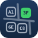

<p align="center"></p>

# Nabe

Nabe (old New York slang for "neighborhood") is a small self-hosted page listing every device on your LAN by MAC
address, with every IPv4, global IPv6, ULA and link-local address seen for it, the way a router's "connected devices"
page does, but including IPv6.

- **Who's there:** it reads the host's neighbor table every 30 s, and every 5 min probes the LAN (an IPv6 all-nodes
  ping from each of the host's addresses, an IPv4 ping sweep) so quiet devices show up too.
- **What they're called:** names come from mDNS (Bonjour), NetBIOS and reverse DNS. Each device shows which of them
  it answered, and the services it announces over mDNS, by name and type (`_airplay._tcp`, `_ssh._tcp`, ...). It's
  a debugging page: everything is shown as it was seen, nothing is hidden or renamed.
- **Groups:** every device sits in a group, alone by default. Drag devices together (a computer's Ethernet and Wi-Fi
  MACs, a phone's rotating private MACs) and rename the group.
- **Memory:** addresses, names and services are kept until they haven't been seen for 7 days, so a device that's
  asleep or gone shows when it was last seen.
- **Wake-on-LAN:** every device gets a Wake button (a device that just shut down still shows online for a few
  minutes), which sends it a magic packet in a broadcast Ethernet frame (as `ether-wake` does). Whether it wakes
  depends on the device: wired, with Wake-on-LAN enabled, and not using a private MAC.
- **No dependencies:** standard-library Python, one small page, a JSON file for state.

## Run it

It needs Linux and the host's network (to read its neighbor table and probe the LAN), so it runs with
`network_mode: host`:

```sh
curl -O https://raw.githubusercontent.com/godric/nabe/main/compose.yaml
IFACE=eth0 docker compose up -d
```

That pulls `ghcr.io/godric/nabe:latest` (amd64 and arm64), built from `main`; `docker compose pull && docker compose up
-d` updates it. Releases are also tagged by version (`ghcr.io/godric/nabe:0.1.0`, `:0.1`). To build it yourself
instead, clone the repo and run `IFACE=eth0 docker compose up -d --build`.

It listens on `127.0.0.1:8097` by default, meant to sit behind a reverse proxy. Set `LISTEN_HOST=0.0.0.0` to reach
it directly from the LAN. There is no authentication: anyone who can open the page can rename and regroup devices.

| Variable | Default | |
|---|---|---|
| `IFACE` | `eth0` | The LAN interface to watch and probe |
| `LISTEN_HOST` | `127.0.0.1` | Address the page is served on |
| `LISTEN_PORT` | `8097` | Port the page is served on |
| `POLL_INTERVAL` | `30` | Seconds between neighbor table reads |
| `PROBE_INTERVAL` | `300` | Seconds between probe rounds (pings, mDNS, NetBIOS, reverse DNS); `0` only probes at start and from the page's "Scan now" |
| `RETENTION_DAYS` | `7` | How long an address, name or service is kept after it was last seen |
| `DATA_DIR` | `/data` | Where `devices.json` (what was seen) and `layout.json` (the groups) are kept |

The container runs as root, as `ping` and Wake-on-LAN need raw sockets.

## How it works

`main.py` runs the polling and probing threads and the web server. In `nabe/`:

- `system.py`: the neighbor table and the host's addresses (iproute2), the pings and Wake-on-LAN
- `mdns.py`: DNS packets, mDNS reverse lookups and service browsing
- `nbns.py`: NetBIOS node status queries
- `store.py`: what was seen, by MAC, the groups, and what the API returns
- `server.py` and `static/`: the page (`/`), `GET /api/devices`, `PUT /api/layout`, `POST /api/probe` and
  `POST /api/wake` (`{"mac": ...}`)

```sh
uv run pytest
uv run ruff check . && uv run ruff format --check .
```

## Releasing

Every user-visible change goes in [CHANGELOG.md](CHANGELOG.md) under the next version. To release: set that version in
`pyproject.toml` (and `uv lock`), date its changelog section, commit, then tag `v<version>` and push the tag. The
image is published as `ghcr.io/godric/nabe:<version>` and `:<major>.<minor>`.

## Icons

`nabe/static/icon.svg` (with MAC octets, for large sizes) and `favicon.svg` (without, for small ones) are the
sources. The PNGs (`apple-touch-icon.png`, 180 px full-bleed for iOS; `icon-192/512.png` and `icon-maskable-512.png`
for the web manifest) were rendered from them with macOS Quick Look (`qlmanage -t -s <size> -o . <file>.svg`).
Full-bleed means `rx="0"` on the tile, and the maskable one scales the drawing by 0.78 around its centre so launcher
masks don't clip it.

## License

[MIT](LICENSE)
